# Pexora - Professional Prompt Workspace

> A desktop app (v3.2.0) for organizing AI prompts: a searchable prompt library with folders, favorites, and fill-in variables, local JSON/CSV backup, and an optional two-way sync to your own Google Sheet.

## Features

- **Prompt library** - Prompts grouped in nested folders with colors, favorites, search, and grid view. Each prompt has a title, keywords, prompt text, note, comments, and order.
- **Variables** - Fill-in placeholders (`variable_options`, `variable_display_names`, `variable_notes`) so one prompt template can be reused with different values.
- **Local storage** - Everything is stored locally in `pexora_backup.json` (with a `.previous.json` mirror). Import and export as JSON or CSV - no account needed.
- **Google Sheets backup & 2-way sync (optional)** - Set up your own Google Sheet sync with the Apps Script code included in the Bengali guide (`docs/backup-guide-bn.html`). It can back up your full library to your Sheet and restore it back. It refuses to push an empty backup over your cloud copy. Each user uses their own Sheet - there is no shared server.
- **Demo data included** - `demo/pexora_backup.demo.json` holds 4 generic example prompts so you can try the library right away.

## Download & Install

1. Go to the [Releases](../../releases) page.
2. Download `Pexora.exe` (portable, single file - no install needed).
3. Double-click it to run. In portable mode your data is stored in the `Data/` folder next to the exe; otherwise it lives in your user data folder.

## How to Use

1. **Library:** Create folders, add prompts, and use variables for the parts that change (for example `{{product}}` or `{{topic}}`).
2. **Backup:** Use Export to save a JSON/CSV copy. To restore, use Import.
3. **Sheets sync:** Follow `docs/backup-guide-bn.html` (Bengali guide) - in short: create a Google Sheet, copy the Apps Script code from the guide into Extensions → Apps Script, deploy it as a web app, then paste your own URL into Pexora's Backup dialog (or save it in `backup_server_url.txt` - see `backup_server_url.txt.example`). Never share your deployed URL: anyone with it can read and overwrite your library.

## Privacy

- By default everything is local. Nothing is sent anywhere unless you set up Sheets sync yourself.
- Sheets sync uses **your own** Google Sheet and Apps Script deployment. This repository ships no deployed URL and no personal prompt library - only the demo set in `demo/`.

## Contributing

Found a bug or have an idea? See [CONTRIBUTING.md](CONTRIBUTING.md).

## License

Distributed under the **PolyForm Noncommercial License 1.0.0** - free for personal, non-commercial use. You may use it and share it, but you may **not** sell it or claim it as your own. See [LICENSE](LICENSE).

## Author

**Moshiur Rahman ([@moshclusive](https://github.com/moshclusive))** - Graphic Designer, Fiverr Level 2 Seller, tool builder.

- LinkedIn: https://www.linkedin.com/in/moshclusive/
- Facebook: https://www.facebook.com/moshclusive
